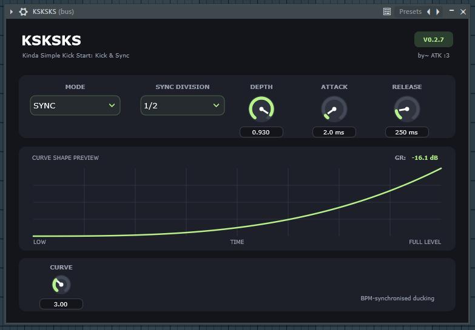
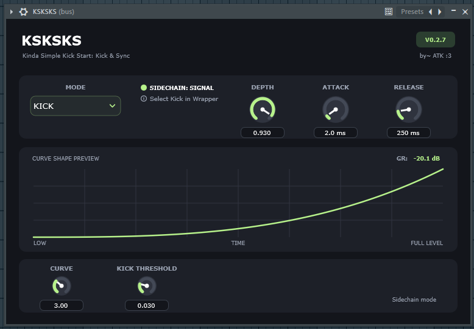
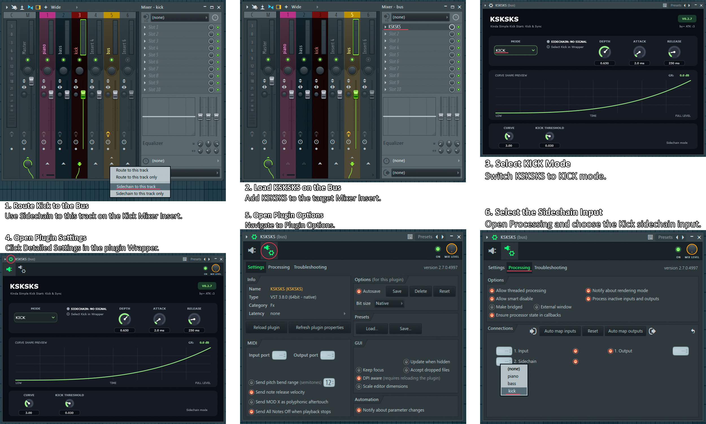

# KSKSKS

**Kinda Simple Kick Start: Kick & Sync**

A simple sidechain ducking plugin with two operating modes: tempo-synchronised ducking and audio-triggered kick ducking.

## Features

- **SYNC mode** — tempo-synchronised ducking based on your DAW's BPM and transport position.
- **KICK mode** — audio-triggered ducking using an external sidechain signal.
- Adjustable ducking depth.
- Multiple rhythmic divisions.
- Adjustable envelope curve.
- Attack and Release controls.
- Sidechain threshold control in KICK mode.
- Gain reduction display.
- Sidechain input indicator.

---

## Interface

### SYNC Mode



Creates rhythmic ducking synchronised to your DAW's tempo.

Available divisions:

- 1/1
- 1/2
- 1/4
- 1/8
- 1/16
- 1/8T

### KICK Mode



Uses an external sidechain signal to trigger ducking.

Adjust the Threshold parameter to control the signal level required to trigger the envelope.

---

## Installation

1. Download or build the KSKSKS plugin.
2. Locate the generated `KSKSKS.vst3` bundle.
3. Copy it to your VST3 plugin directory.

Default VST3 directory on Windows:

```text
C:\Program Files\Common Files\VST3
```

4. Open your DAW and perform a plugin scan if necessary.
5. Find KSKSKS in your effects list and load it onto a track or Mixer Insert.

If the plugin isn't detected, check your DAW's plugin scan paths.

---

## FL Studio Sidechain Setup

KSKSKS requires an external sidechain signal when using KICK mode.

Follow the steps below to configure it in FL Studio.



1. **Route Kick to the Bus**  
   Use *Sidechain to this track* on the Kick Mixer Insert.

2. **Load KSKSKS on the Bus**  
   Add KSKSKS to the target Mixer Insert.

3. **Select KICK Mode**  
   Switch KSKSKS to KICK mode.

4. **Open Plugin Settings**  
   Click *Detailed Settings* in the plugin Wrapper.

5. **Open Plugin Options**  
   Navigate to *Plugin Options*.

6. **Select the Sidechain Input**  
   Open *Processing* and select the incoming Kick sidechain channel.

After completing these steps, KSKSKS should receive the external kick signal and trigger ducking.

---

## Controls

| Control | Description |
|---|---|
| MODE | Selects SYNC or KICK mode. |
| DEPTH | Controls the amount of volume reduction. |
| DIVISION | Sets the rhythmic division in SYNC mode. |
| CURVE | Controls the shape of the ducking envelope. |
| ATTACK | Sets the attack time. |
| RELEASE | Sets the release time. |
| THRESHOLD | Sets the trigger threshold in KICK mode. |

---

## Building from Source

### Requirements

- CMake 3.22 or newer
- A compatible C++ compiler and build system
- JUCE 9.0.4

JUCE is not included in this repository.

Download it from the official release page:

[JUCE 9.0.4 — GitHub](https://github.com/juce-framework/JUCE/releases/tag/9.0.4)

### Configure

```powershell
cmake -B Build -S . -DJUCE_DIR="C:/path/to/JUCE"
```

Replace `C:/path/to/JUCE` with the path to your JUCE directory.

CMake automatically selects the default generator available on your system. You can specify one manually using `-G` if needed.

### Build

```powershell
cmake --build Build --config Release --target KSKSKS_VST3
```

The generated plugin should be located under:

```text
Build/KSKSKS_artefacts/Release/VST3/
```

---

## Compatibility

KSKSKS is built as a VST3 plugin.

Currently tested on Windows with FL Studio. Other operating systems and DAWs have not been tested.

---

*Why pay for something you can get for free?*

**by~ ATK :3**